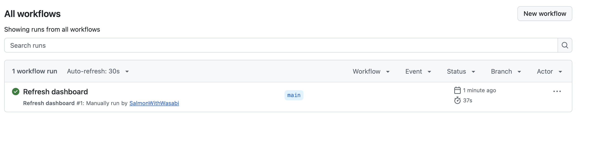

# Evidence of verification

## 1. Data checks (one observation per series against the original source)

Dashboard values are from the refresh at 2026-11-18 07:24 UTC (see `docs/refresh_log.csv`).
Fill in the "Original source" column from the source page and attach a screenshot of each.

| Series | Observation | Dashboard value | Original source value | Where to check | Match? |
|---|---|---|---|---|---|
| USD/JPY | 2026-11-13 | 159.93 JPY per USD | | Federal Reserve H.10, Japan historical rates: https://www.federalreserve.gov/releases/h10/hist/dat00_ja.htm | |
| Overnight call rate | Oct 2026 (monthly avg) | 1.227% | | BOJ Time-Series Data Search, "Call rate, uncollateralized overnight, average": https://www.stat-search.boj.or.jp/ | |
| 10-year JGB yield | 2026-11-17 | 2.925% | | MOF JGB interest rates (10Y column): https://www.mof.go.jp/english/policy/jgbs/reference/interest_rate/index.htm | |
| CPI, all items, YoY | Sep 2026 | 2.15% (published to 1 decimal: 2.1%) | | Statistics Bureau CPI, national, latest monthly release: https://www.stat.go.jp/english/data/cpi/index.html | |
| CPI less fresh food, YoY | Sep 2026 | 2.15% (2.1%) | | same release | |
| Real GDP, YoY | Q3 2026 (Jul–Sep) | 1.16% (level ¥599,455.9bn vs ¥592,604.6bn in Q3 2025, chained 2015 yen, SA) | | Cabinet Office QE release: https://www.esri.cao.go.jp/en/sna/sokuhou/sokuhou_top.html | |
| Unemployment rate | Sep 2026 | 2.4% (SA) | | Statistics Bureau Labour Force Survey: https://www.stat.go.jp/english/data/roudou/index.html | |
| REER | Sep 2026 | 66.61 (2020 = 100) | | BIS effective exchange rates, Japan, broad, real: https://data.bis.org/topics/EER | |

Notes on expected small differences:
- The call rate is a monthly average of daily rates, so compare it with the BOJ's monthly average.
- CPI and GDP growth are computed from index levels, so they can differ from the officially published rate by about 0.1 pp because of rounding. GDP is revised with each release: compare with the release in force on the refresh date.
- The 10-year JGB yield and CPI are read directly from the MOF and Statistics Bureau files, so they match the source by construction; the check confirms the parser reads the right column.

## 2. Successful refresh

- Two successful refreshes on 2026-11-18 (07:22 and 07:24 UTC), 7/7 series updated each time: `evidence/run_log_1.txt`, `evidence/run_log_2.txt`, and the rows in `docs/refresh_log.csv`. Values did not change between the runs because no source released new data in between.
- Dashboard after the refresh: `evidence/dashboard_screenshot.png` (header shows "Last successful refresh"; each chart shows its own latest observation date).
- Refresh on GitHub Actions: the "Refresh dashboard" workflow (`.github/workflows/refresh.yml`) in https://github.com/SalmonWithWasabi/japan-dashboard completed successfully (run #1, triggered manually with "Run workflow", branch `main`, 37 s, green check): `evidence/github_actions_run.png`. The workflow also runs on a daily schedule (01:17 UTC).

  

## 3. Issues found while building, and fixes

- FRED rejected requests with a browser-style User-Agent from the script → use the default python-requests User-Agent and retry up to 3 times.
- The OECD/FRED monthly CPI series for Japan stops at June 2021 → switched CPI to the Statistics Bureau's own CSV files (2025 and 2020 base), keeping OECD only for 2010–2020 history.
- The first chart rendered at full page width before the grid was laid out → fixed two-column grid and a resize on page load.
